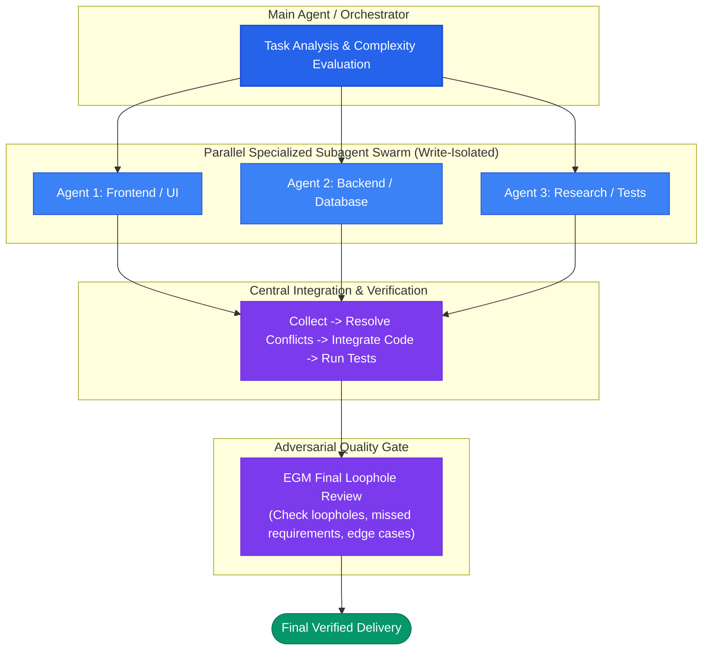
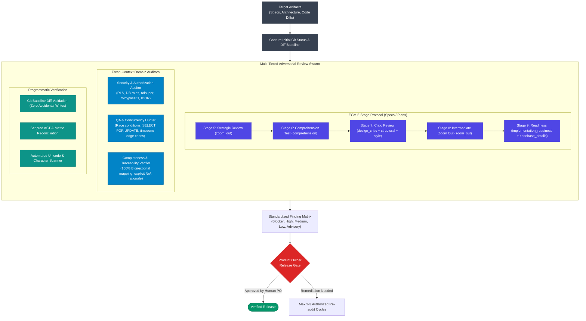

<div align="center">

# ⚡ Agent Powerpack Skills

**Universal Multi-Agent Orchestration & Adversarial Review Toolkit for AI Coding Agents**

[](https://opensource.org/licenses/MIT)
[](https://antigravity.google)
[](https://claude.ai)
[](https://cursor.com)
[](https://github.com)
[](http://makeapullrequest.com)

*Battle-tested skills that give your AI coding agents enterprise-grade multi-agent teamwork, parallel swarm orchestration, and deep adversarial quality gates.*

</div>

---

## 🚀 Overview

Modern AI coding agents (Antigravity CLI, Claude Code, Cursor, OpenCode) are powerful individually, but they stumble when handling complex, full-stack tasks or catching subtle architectural regressions.

**Agent Powerpack Skills** provides two flagship, production-grade skills that transform single-threaded agents into a cohesive engineering workforce:

1. **`/teamform` — Parallel Swarm Orchestrator**:
   Analyzes task complexity, spawns 2-3 specialized subagents with strict write isolation (e.g. Frontend/UI, Backend/DB, Tests/Research), integrates changes centrally, and conducts an EGM final loophole check before delivery.

2. **`/hard-review` — Deep Adversarial Review Engine**:
   A strictly read-only audit engine combining a 5-stage EGM review protocol, fresh-context specialized review personas (Security & RLS, Concurrency & QA, 100% Traceability), read-only Git baseline comparison, and structured finding matrices.

---

## 🏗️ Architecture & Execution Flows

### 1. `/teamform` Execution Flow



---

### 2. `/hard-review` Adversarial Audit Pipeline



---

## 📦 Compatibility Matrix

| AI Coding Agent | Configuration Path | Skill Discovery | Status |
|---|---|---|---|
| **Google Antigravity CLI** | `~/.gemini/skills/` | Native CLI auto-discovery | Supported |
| **Anthropic Claude Code** | `~/.claude/skills/` | Automatic slash command | Supported |
| **Cursor / Windsurf** | `.cursor/rules/`, `.cursorrules` | Workspace rules integration | Supported |
| **OpenCode CLI** | `~/.opencode/skills/` | Native skill registry | Supported |
| **OpenAI Codex / CLI** | Custom prompt wrappers | Command adapter | Supported |

---

## ⚡ Installation

### 1-Line Universal Installer (Recommended)
Automatically detects your installed agent environments and links the skills:

```bash
curl -fsSL https://raw.githubusercontent.com/shoaib/agent-powerpack-skills/main/install.sh | bash
```

### Manual Installation
Clone the repository and run the installer for your target agent:

```bash
git clone https://github.com/shoaib/agent-powerpack-skills.git
cd agent-powerpack-skills

# Install to Google Antigravity
./install.sh --antigravity

# Install to Claude Code
./install.sh --claude

# Install to Cursor / Windsurf
./install.sh --cursor

# Install to all supported environments
./install.sh --all
```

---

## 🛡️ Core Invariants & Governance

1. **Write-Isolation Invariant**:
   Parallel subagents are strictly partitioned into disjoint write boundaries. Concurrent edits to the same file or schema are forbidden. All merging and schema modifications are performed centrally.

2. **Concurrency Budget Limit**:
   Caps execution at 4 concurrent subagents maximum (normally 2-3), preventing host memory exhaustion on 8 GB / 16 GB developer machines.

3. **Read-Only Hard-Review Invariant**:
   `/hard-review` never mutates reviewed source artifacts or executes unauthorized auto-fixes. Findings are compiled into designated report directories with diff-based remediations.

4. **Product Owner Release Gate**:
   Strict rule prohibiting production release, milestone sign-off, or issue closure without explicit human Product Owner approval.

---

## 📄 License

Distributed under the [MIT License](LICENSE). Free for personal, commercial, and enterprise use.

---

<div align="center">
  <b>Built with precision for the next generation of autonomous engineering agents.</b><br/>
  Star ⭐ this repo if you find it valuable!
</div>
